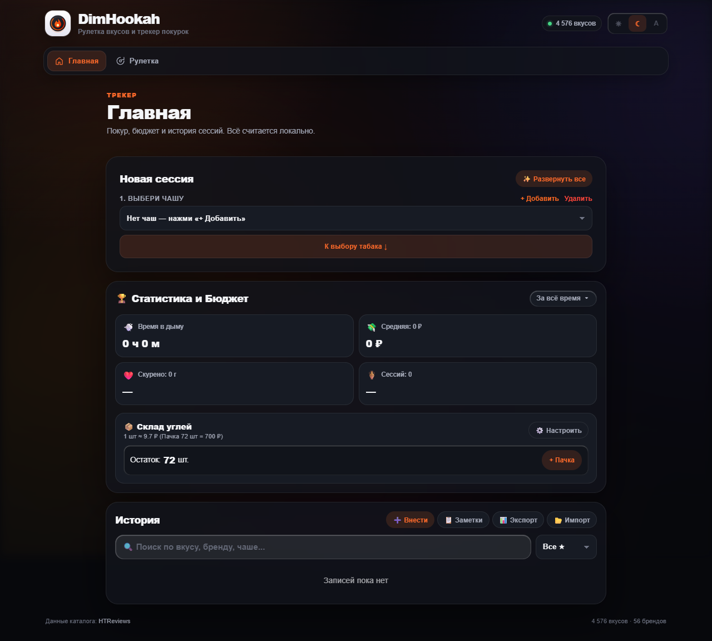
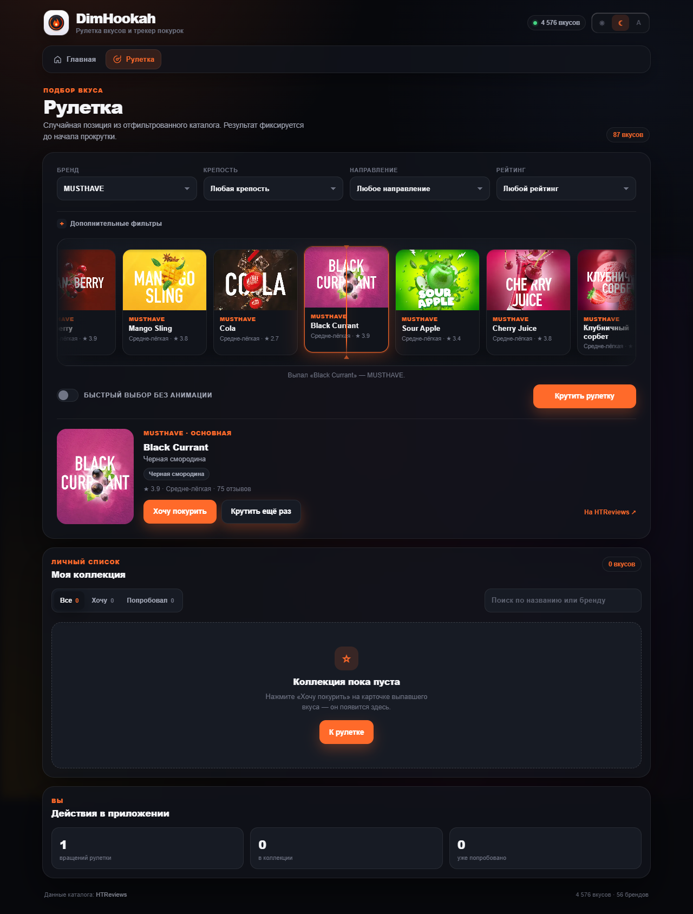
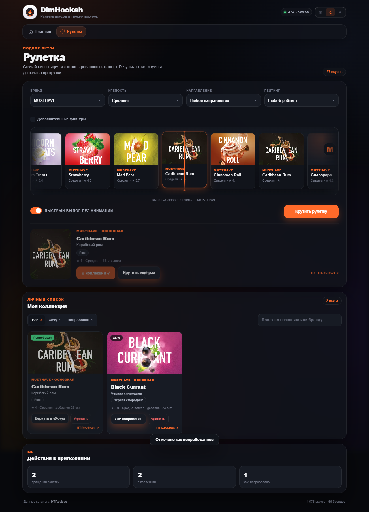
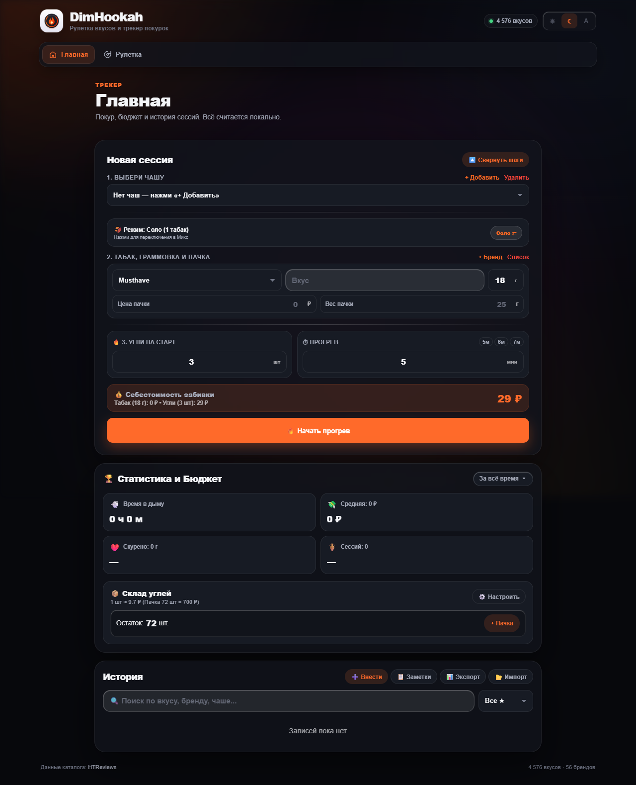

# DimHookah

Современное PWA для кальяна: рулетка случайного вкуса по реальному каталогу
[HTReviews](https://htreviews.org), личная коллекция «Хочу покурить» и трекер
покурок с таймером, углями и историей.



## Возможности

- **Рулетка вкусов** — горизонтальная лента карточек, плавная прокрутка ровно
  около 5 секунд и остановка на заранее зафиксированном результате.
- **Быстрый выбор** — отключаемая анимация: случайный вкус показывается сразу.
  Настройка сохраняется между перезагрузками.
- **Каскадные фильтры** — бренд, крепость, вкусовое направление и рейтинг.
  Список значений каждого фильтра строится только из доступных сочетаний.
- **Моя коллекция** — сохранение вкусов в `localStorage`, защита от дубликатов,
  отметка «Уже попробовал» и удаление.
- **Действия в приложении** — количество вращений, размер коллекции и число
  попробованных вкусов.
- **Трекер покурок** — прогрев, таймер, микс, себестоимость, угли и история.
- **PWA** — установка на телефон, service worker и офлайн-кеш после первого
  визита.

## Скриншоты



<details>
<summary>Коллекция и трекер</summary>





</details>

## Вкладки

| Вкладка | Что внутри |
| --- | --- |
| **Главная** | Блоки «Новая сессия», «Статистика и Бюджет», «История» |
| **Рулетка** | Блоки «Рулетка», «Моя коллекция», «Действия в приложении» |

## Быстрый старт

Нужен Node.js 18+ и любой статический HTTP-сервер. `flavors.json` загружается
через `fetch`, поэтому открывать `index.html` как `file://` нельзя.

```bash
npm install
npx serve .
# или
python -m http.server 8000
```

Откройте адрес, который выдал сервер (например, `http://localhost:3000`).
Для работы каталога интернет не обязателен, если `flavors.json` уже лежит в
проекте. Интернет нужен только при обновлении каталога через скрапер.

## Как работает рулетка

1. Пользователь выбирает фильтры. Все условия применяются совместно.
2. Перед началом анимации приложение случайно выбирает вкус из подходящих
   записей и запоминает его.
3. Строится длинная лента карточек, победитель ставится в известную позицию.
4. Лента прокручивается 5 секунд с замедлением и останавливается на этой
   карточке. Подмены результата в конце нет.
5. Появляется карточка с названием, брендом, крепостью, рейтингом, тегами и
   изображением, а также действия «Хочу покурить» и «Крутить ещё раз».

Дополнительно:

- повторный запуск во время прокрутки заблокирован;
- если изображения нет или оно не загрузилось, показывается заглушка;
- изображения кешируются браузером и не скачиваются заново на каждом вращении;
- при пустой выдаче показывается сообщение, а кнопка запуска блокируется;
- снятые с производства вкусы по умолчанию не участвуют в выборе;
- лимитированные вкусы имеют отдельный фильтр и бейдж.

### Каскадные фильтры

Фильтры бренда, крепости, направления и рейтинга зависят друг от друга:

- варианты каждого селекта строятся из записей, подходящих под остальные
  выбранные фильтры;
- например, у бренда без ореховых вкусов направление «Ореховый» не появится;
- если выбранное значение перестало быть доступным, оно сбрасывается на
  «любое», чтобы не получить пустую выдачу;
- из подписей убраны количества, значения отсортированы по алфавиту
  (рейтинг — по возрастанию порога);
- число вкусов, подходящих под текущий запрос, остаётся в бейдже рядом с
  заголовком рулетки.

**Быстрый выбор** — переключатель «Быстрый выбор без анимации». Состояние
хранится в `localStorage` под ключом `hookah_roulette_fast`.

## Коллекция

Коллекция хранится только в браузере:

- ключ `hookah_collection_v1`;
- запись: `{ slug, addedAt, tried, triedAt }`;
- дубликаты определяются по `slug` и не создаются;
- кнопка «Уже попробовал» обратима;
- список и статусы сохраняются после перезагрузки;
- блок «Моя коллекция» находится на вкладке «Рулетка» и содержит поиск,
  фильтры «Все / Хочу / Попробовал» и удаление.

Количество вращений хранится отдельно в `hookah_roulette_spins`.

## Каталог

`flavors.json` — массив нормализованных вкусов. Приложение умеет читать как
новую схему, так и старые записи, где `tags` были строками.

Текущее состояние каталога:

| Показатель | Значение |
| --- | --- |
| Всего вкусов | 4 576 |
| Брендов с выпускаемыми вкусами | 56 |
| Актуальных (без снятых) | 4 576 |
| Лимитированных | 63 |
| С крепостью | 4 043 |
| С изображением | 4 567 |
| Снятых с производства | 0 |

Каталог собран по всем 60 брендам текущего топа HTReviews. У четырёх брендов
(Smoke Angels, Leteam, Cobra, Aircraft) на сайте нет ни одного выпускаемого
вкуса — только снятые с производства, поэтому в JSON они не попали.
В каталог включаются только статусы «Выпускается» и «Лимитированный»; снятые
с производства, неподтверждённые и шуточные позиции исключены.

### MUSTHAVE

На странице бренда HTReviews заявлено 104 вкуса. Публичный API отдаёт 91:
87 актуальных и 4 снятых с производства. Ещё 13 позиций сайт не отдаёт ни в
списке бренда, ни в API, ни в поиске.

В `flavors.json` лежат 87 выпускаемых вкусов MUSTHAVE. Четыре снятых с
производства вкуса в текущий каталог не включаются; их можно добавить при
пересборке флагом `--include-discontinued`. Ещё 13 позиций сайт не отдаёт ни в
списке бренда, ни в API, ни в поиске.

## Обновление каталога

Скрапер использует API HTReviews, а не HTML-пагинацию:

- `GET /getData?action=brands` — рейтинг брендов;
- `POST /postData` с `action: "objectByBrand"` — вкусы бренда;
- пагинация идёт до заявленного `data-count`, поэтому короткая страница не
  обрывает список;
- бренд вне топ-60 дорезолвится через `/tobaccos/<slug>`;
- есть повторные попытки при `5xx`, `429` и сетевых ошибках.

```bash
npm run scrape                 # обновить бренды из flavors.json + MUSTHAVE
npm run scrape -- --dry-run    # показать статистику без записи
npm run scrape -- --clean      # собрать топ-60 брендов заново
npm run scrape -- --clean --all-brands
npm run scrape -- --only-brand musthave --out debug/musthave.json
npm run scrape -- --include-discontinued
```

По умолчанию существующий каталог не удаляется: обновляются бренды, которые уже
есть в `flavors.json`, и добавляется `musthave`. Без `--include-discontinued`
снятые с производства позиции не попадут в файл.

Резервные копии каталога:
[до добавления MUSTHAVE](backups/flavors-before-musthave-2026-10-23.json) и
[старый вариант на 41 бренд](backups/flavors-41-brands-2026-10-23.json).

## Структура проекта

| Путь | Назначение |
| --- | --- |
| `index.html` | Разметка приложения и вкладок |
| `ui.css` | Новый тёмный интерфейс, адаптивность, рулетка, коллекция |
| `style.css` | Базовая тема и стили старых компонентов трекера |
| `catalog-ui.js` | Вкладки, каскадные фильтры, рулетка, коллекция, localStorage |
| `lib/catalog-core.js` | Чистые функции: нормализация, фильтры, случайный выбор, коллекция |
| `app.js` | Трекер сессий, таймеры, история, экспорт/импорт |
| `lib/htreviews.js` | API-клиент и нормализация HTReviews |
| `scraper.js` | CLI обновления каталога |
| `flavors.json` | Каталог вкусов |
| `sw.js` | Service worker, кеш `dimhookah-pwa-v13` |
| `manifest.json` | PWA-манифест |
| `test/` | Модульные, live- и e2e-тесты |
| `docs/` | Скриншоты для README |
| `backups/` | Проверенная резервная копия каталога |

## Тесты

```bash
npm test          # модульные и каталожные тесты + проверка синтаксиса
npm run test:live # реальные запросы к HTReviews
npm run test:e2e  # Playwright + Chrome: полный пользовательский сценарий
```

`npm test` запускает `test/all.test.js` напрямую, без встроенного
`node --test` runner: в ограниченной Windows-песочнице runner пытается
spawn-ить дочерний процесс и получает `EPERM`.

E2E-тест проверяет:

- две вкладки и наличие всех трёх блоков на каждой;
- каскадные фильтры: недоступное направление не появляется у бренда,
  подписи без количеств и отсортированы по алфавиту;
- полную рулетку (~5 секунд) и совпадение карточки-победителя с результатом;
- быстрый выбор без анимации;
- добавление в коллекцию, защиту от дубликатов, «попробовал», удаление;
- сохранение коллекции после перезагрузки;
- работу старого трекера и отсутствие ошибок JavaScript;
- отсутствие горизонтального переполнения на экране 390 px.

E2E требует обычного окружения с возможностью запускать Chrome. При
необходимости путь задаётся через `CHROME_PATH`.

## PWA и кеш

`sw.js` использует стратегию network-first и кеширует оболочку приложения и
каталог. При изменении списка файлов поднимайте `CACHE_NAME`; текущая версия —
`dimhookah-pwa-v13`.

## Приватность

- Нет сервера, регистрации и аналитики.
- Нет токенов, API-ключей и персональных данных в репозитории.
- Коллекция, настройки темы и рулетки хранятся только в `localStorage` браузера.
- Каталог и изображения загружаются с публичного HTReviews.

## Лицензия

ISC. Данные каталога принадлежат HTReviews; приложение не является официальным
клиентом сайта.
